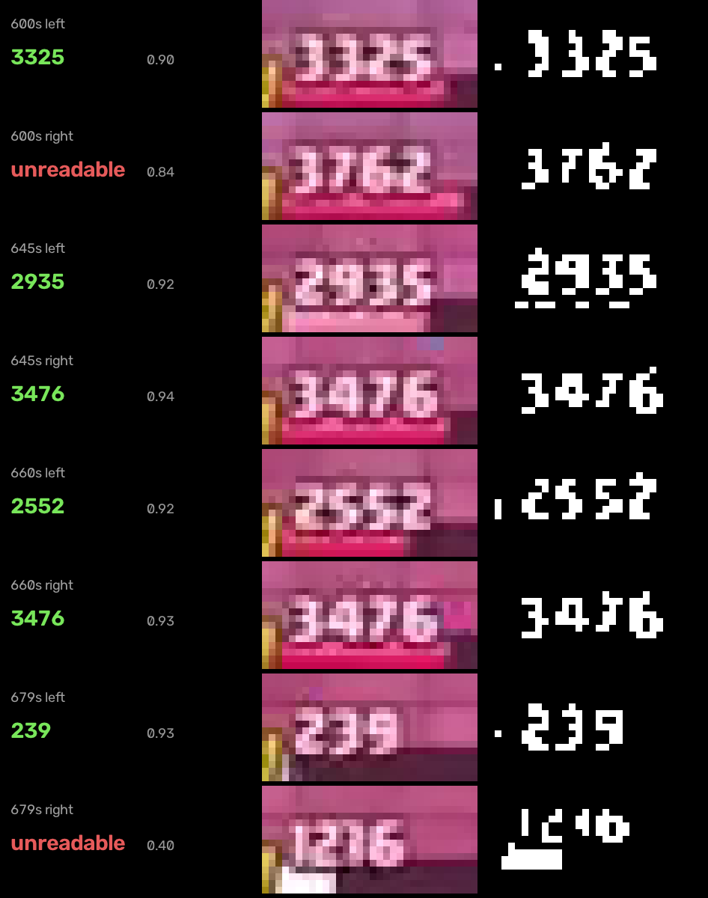

# Spell Cycle Counter

**How many casts does it take to delete that tower?**

Spell cycling is the Clash Royale plan where you ignore the board and chip a
tower down with spells alone. It works because spell damage to a crown tower
is guaranteed: no defence, no blocking, no trading. So the number of casts is
not a guess, it is arithmetic.

This program does that arithmetic for you, live, off a recorded match. It
reads the health number the game prints above each enemy princess tower,
finds which spells are sitting in your hand, and prints a number on each
one: how many casts of that spell finish off the weaker tower.


Twelve Fireballs would finish that tower, so the card in hand is boxed and
labelled 12. Watch the clip through: the spell gets cast, the detector picks
the projectile up in flight, tags the blast where it lands, and the count
drops as the tower's health does.

**You can check the arithmetic without trusting any of this.** In
[`output/demo_frame.png`](output/demo_frame.png) the enemy left tower reads
**3325** on screen and the card is labelled **14**. A level 16 Fireball does
253 to a crown tower, and 3325 / 253 = 13.1, so 14 casts. Both numbers are
in the same picture.

Full annotated clip: [`output/videoplayback_spellcycle.mp4`](output/videoplayback_spellcycle.mp4)
(54 seconds, 1619 frames).

---

## What it detects

Three things:

1. **Spells in the arena** — the projectile in flight and the blast where it
   lands — with a YOLOv8n detector fine-tuned on this game.
2. **The enemy princess towers' health**, by reading the number the game
   prints above each bar, one glyph at a time.
3. **Which of your four hand slots hold a damaging spell**, from the card art.

Non-spell cards are deliberately ignored. A Goblin Gang has no guaranteed
tower damage, so no count can be put on it.

## Approach, and why

**The right tool depends on whether the thing moves**, and this project has
both kinds of target, so it uses both kinds of method.

The hand and the health numbers never move. They sit at fixed positions in a
rendered interface whose fonts and coordinates the game guarantees. A learned
detector would be strictly worse there: more machinery, more failure modes,
and less accuracy than simply reading the pixels. So those use template
matching.

A spell in flight is the opposite. It has no fixed position, no fixed scale,
and it crosses whatever happens to be on the board at the time. No rectangle
and no colour rule can find it, because the arena is full of permanently
orange furniture: bridge gates, king crowns, every gold level badge. That is
what the model is for, and the "The model" section below covers it.

**Hand: template matching against the official card art.** The four slots sit
at fixed screen positions, so each slot is matched against all seven spell
images rather than sliding templates over the whole frame. That is faster and
it structurally cannot put a card in the wrong slot. Card art is downloaded
from RoyaleAPI's asset mirror into `cards/`.

The separation is clean. In the demo frames:

| Case | Match score |
|---|---|
| Fireball really in hand | 0.86 to 0.92 |
| Best false positive (greyed-out post-match card) | 0.72 |
| Everything else | below 0.56 |

Hence the default `--threshold 0.78`.

**Health: reading the number the game prints.** The first version of this
program measured the red fill of the health bar instead, because at 298x640
the digits are seven pixels tall and a first attempt at reading them came
back with `3038` for a clear `4858`. Measuring the bar was a mistake. A
bar only gives a *fraction*, so turning it into health needs the tower's
maximum, which is only on screen while the tower is still undamaged. A wrong
guess there is invisible and scales every count. It was fragile on top of
that: where the counter now reads 14, the first release read 9.

The number is right there, and the thing that makes it readable is that the
game draws it in one fixed font at one fixed size. That turns "recognise
text" into "match ten known glyphs", which is tractable at seven pixels.
`digits.py` does exactly that, and the section below covers it.



Left to right: the strip as it comes off the video, the ink mask after
normalising and dropping anything strongly coloured, and the decoded number
with its score. The two red rows are the reader declining to answer, which is
the behaviour that matters most; see "Keeping the health reading honest".

## The model

**YOLOv8n, fine-tuned from COCO weights on frames cut from this video.** Two
classes: `spell_in_flight` and `spell_impact`. Starting from pretrained
weights rather than from scratch matters — a few hundred frames is nowhere
near enough to learn edges and blobs from nothing, but it is plenty to
re-point a backbone that already has them at one new object.

### Getting labels without labelling by hand

Hand-annotating thousands of frames was not realistic, so the labels come
from a two-stage trick that `tools/build_dataset.py` implements:

1. **An impact is easy to find.** A spell blast is far larger than any gold
   badge in the arena, so a strict area threshold catches it. That gives one
   reliable anchor per cast: 28 events across 23 minutes.
2. **A projectile is hard to find, but it has to arrive somewhere.** Searching
   all 42,284 frames for a small orange ball is hopeless. Searching only the
   one second before a known blast, and only near where that blast happened,
   is easy. An impossible global search becomes a trivial local one.

The first version of this labelled bridges as fireballs. The arena is full of
permanently orange furniture, and colour cannot tell a bridge gate from a
projectile. The fix is a **static-orange prior**: sample 798 frames across the
video, measure how often each pixel is orange, and refuse to label anything in
a pixel that is orange most of the time. A spell is by definition transient.
That one filter removed 212 bad labels, and every box in the verification
montage after it was a genuine projectile.


Bright areas are furniture the labeller must ignore: the two bridge gates, the
king crowns, every level badge, the cards in hand.

### Training

| | |
|---|---|
| Base weights | `yolov8n.pt`, COCO-pretrained |
| Classes | `spell_in_flight`, `spell_impact` |
| Source | 28 cast events across 23 minutes of play |
| Train | 915 images: 465 in-flight, 167 impact, 283 negatives |
| Validation | 333 images: 163 in-flight, 53 impact, 117 negatives |
| Epochs | 20, CPU only |
| Image size | 512 long side, rectangular batches |

**Negatives matter as much as positives.** 400 frames with gold badges, king
crowns and fire-effect troops but no spell are included on purpose. Without
them the model learns "orange means spell" and you have trained the colour
rule you were trying to replace.

**The split holds out whole events, never single frames.** Consecutive frames
of one cast are near-duplicates; splitting at random would leak them across
train and validation and make the score meaningless. All 30 frames of a cast
go to the same side of the split.

### Results

On the held-out cast events, which the model never saw in training:

| Class | AP50 | Precision | Recall |
|---|---|---|---|
| `spell_impact` | 0.986 | 0.919 | 0.981 |
| `spell_in_flight` | 0.538 | 0.773 | 0.466 |
| **overall** | **mAP50 0.762** | | **mAP50-95 0.504** |

**The gap between those two rows is the point of the whole exercise.** The
blast is nearly solved at 0.986, and it should be: it is huge, bright and
sits still for a few frames, which is exactly why a colour threshold could
label it in the first place. The projectile scores 0.538 with recall under a
half, because it is a dozen pixels wide, moves the width of itself between
frames, and crosses a background that is already pink and orange.

So the easy class is easy and the hard class is hard, which is the honest
result. The model earns its place on the second row, not the first. Missing
roughly half the in-flight frames still tracks the spell fine in practice,
because a cast lasts 20 to 30 frames and catching a third of them draws a
clean path.


Four frames across one cast: the projectile tagged in flight, then the blast
tagged on impact as it blooms and fades.

## How the code processes the video

`spellcycle.py` runs one loop per frame:

1. **Read each enemy tower's health number.** Normalise the strip, line it up
   vertically, then walk the glyphs left to right. Covered in detail below.
2. **Vote.** No single frame is trusted; a number becomes the tower's health
   once most of the last third of a second agrees on it.
3. **Pick the target.** The weakest tower still standing. A destroyed tower is
   not a zero-health target, it is removed from the running.
4. **Read the hand** every fifth frame, since a hand only changes when a card
   is played.
5. **Run the detector** on the same fifth frame, giving any spell in flight or
   blast in the arena.
6. **Do the arithmetic.** `ceil(health / crown tower damage)`, which always
   rounds up, because a tower on 1 health still needs a whole cast.
7. **Score the impact.** When a blast appears on the enemy half, note which
   tower it landed on and how much health that tower loses over the next 1.6
   seconds. This is reported as health lost in a window, not as the spell's
   damage, because anything else hitting the tower at the same moment is
   counted too. It is a sanity check on the counter, not a measurement of the
   spell in isolation.
8. **Draw** the spell boxes with their counts, and the detector's boxes on the
   projectile and the blast. No health readout is drawn, because the game is
   already printing it two inches up the screen.

### How the digits get read

Four steps, all in `digits.py`:

1. **Normalise.** The number is white on whatever the arena happens to be, so
   brightness is rescaled against the strip's own 20th and 99th percentile
   and anything strongly coloured is dropped. That kills the gold level badge
   sitting immediately to its left.
2. **Line up vertically.** The HUD shifts a pixel between matches, and at a
   seven pixel glyph height one row of slip is the difference between a 5 and
   an 8. The strip is slid until the ink's row centroid sits where the
   templates expect it, and the decode is then tried one row either side.
3. **Place glyphs left to right.** Digits are proportional — a 1 advances
   about 4 pixels and an 8 about 6 — so the search walks the string one glyph
   at a time at quarter-pixel resolution, keeping only the best parse that
   reaches each position.
4. **Check the whole string.** The best dozen parses are re-drawn from the
   templates and compared against the strip as a picture. This is what
   catches a parse whose four glyphs all score well but which leaves a fifth
   digit's ink sitting unexplained at the end.

The ten glyphs come from `tools/build_digits.py`, which cuts them out of
frames whose value is written down in `data/hp_labels.json` — read by eye at
10x zoom. Knowing the value tells the splitter how many digits to cut the
strip into, which is the only supervision it needs. It builds them twice:
the first pass works out which row each training strip's text really sits on,
and the second re-cuts at that offset. Without that, a one-row slip in a
handful of frames blurs the averages enough that an 8 starts matching
everything, which cost about 20 points of accuracy.

### Keeping the health reading honest

A number gets walked over by troops, washed out by a spell animation, and
hidden under the card you are dragging. It is also animated: after a hit the
game rolls the number down to its new value, and a mid-roll frame is a
smear that is not any number at all. Three rules handle all of it:

- **An unreadable frame is unknown, not zero.** The reader returns nothing
  rather than guessing. Reporting zero would latch the tower to dead the
  first time a spell flashed over it.
- **Nothing is believed on one frame.** A value has to be what most of the
  last third of a second says. The score gate does the heavy lifting here:
  of the readings the decoder is willing to return, a correct one scores 0.93
  at the median and a wrong one 0.84, so the cut at 0.86 throws away three
  quarters of the wrong readings for 15% of the right ones. Discarded frames
  cost nothing, because the vote holds its last value meanwhile.
- **Towers never heal.** A reading that claims a tower gained health needs a
  near-unanimous window before it is believed, and so does a drop of more
  than 40% in a third of a second.

When the number is unreadable the last confirmed value simply stands — that
is the fallback. Four seconds of continuous absence means the tower is gone,
since nothing covers the number that long but destruction.

### Where the damage numbers come from

This was the fiddliest part to get right, and `tools/build_spell_table.py`
documents it in full. Two traps:

- **Crown tower damage is not area damage.** Spells deal heavily reduced
  damage to towers. A level 16 Fireball does 1101 to troops but 253 to a
  tower. Using the wrong one would overstate every count by four times.
- **The published percentage does not match the game.** The card data says a
  Fireball does 30% of its area damage to a crown tower, which at level 16
  would be 330. In this recording two separate level 16 Fireballs each take
  exactly **253**, at 653.9s and again at 668.0s. 253 / 330 = 0.766.

So the table does not trust the percentage on its own. The game's own
per-level damage arrays give the shape, and one global factor is fitted to
the single number the footage actually lets me measure. The data hints that
such a global exists: the Fireball record carries
`deflect_behaviour: UseSpellsTowerDamageMul`, a spell-versus-tower multiplier
living outside the per-card entry.

The indexing rule those arrays use is not documented anywhere I could find,
so I derived it and then checked it: array length encodes rarity, and index
equals level minus the rarity's starting level (Common 1, Rare 3, Epic 6,
Legendary 9). It reproduces both universally published Fireball figures
exactly — 572 area damage at level 9 and 689 at level 11.

Crown tower damage, with the casts each needs for the 3325 health tower in
the demo:

| Spell | Level 11 | Level 16 | Casts at level 16 |
|---|---|---|---|
| Rocket | 284 | 454 | 8 |
| Lightning | 243 | 388 | 9 |
| Fireball | 158 | **253** | 14 |
| The Log | 44 | 71 | 47 |
| Giant Snowball | 44 | 70 | 48 |
| Zap | 44 | 70 | 48 |
| Arrows | 28 | 45 | 74 |

**Only the bold number is measured.** Every other cell inherits the same
0.766 factor, which is right only if that factor really is global. If
Supercell instead changed Fireball's own percentage, the other six spells are
off by exactly that much. They are flagged `"verified": false` in
`data/spells.json` for that reason. Fixing it properly needs footage of each
spell hitting a tower, which this recording does not contain.

Poison and Earthquake are deliberately excluded. They deal damage over time,
so "how many casts" has no honest answer for them.

## What the custom behaviour does

Detecting things is the easy half. The custom logic is everything that turns
two detections into one actionable number:

- **Picks a target.** The weakest princess tower still standing. A destroyed
  tower is removed from the running rather than treated as a zero-health
  target, which would otherwise make every count read 0.
- **Converts health into casts.** `ceil(health / crown tower damage)`, always
  rounding up, because a tower on 1 health still costs a whole cast.
- **Scales to the spell's level.** `--spell-level` re-reads the whole damage
  table, so a level 16 Rocket correctly needs fewer casts than a level 11 one.
- **Labels the right card.** Each count is drawn on the specific hand slot
  holding that spell, and only on spells, since nothing else does guaranteed
  tower damage.
- **Survives a messy video.** The three rules under "Keeping the health
  reading honest" above are the real work: a number hidden by a troop or
  mid-roll after a hit holds its last value instead of collapsing the count.
- **Watches casts land.** The detector's impact class turns every blast on the
  enemy half into an event: which tower it hit, and how much health that tower
  lost afterwards. That window catches any troop damage landing at the same
  time, so it is a sanity check rather than a clean per-spell measurement, and
  the output says so.
- **Logs every change.** A line is printed whenever the count changes, so the
  run is auditable without scrubbing the video:

```
[ 636.40s] weakest right 3476 HP:  Fireball x14
[ 636.90s] weakest left 3325 HP:  Fireball x14
[ 645.31s] weakest left 2935 HP:  Fireball x12
[ 646.91s] weakest left 2805 HP:  Fireball x12
[ 653.68s] spell impact #1 on the left tower
[ 655.29s]   left tower 2805 -> 2552, lost 253 HP over 1.6s
[ 664.03s] weakest left 2552 HP:  Fireball x11
[ 667.70s] spell impact #2 on the left tower
[ 669.30s]   left tower 2552 -> 2299, lost 253 HP over 1.6s
```

**Those two impact lines are the program marking its own homework.** The
table says a level 16 Fireball does 253 to a crown tower. The detector found
the blast, the reader watched the health, and the tower lost exactly 253
both times. That is the check that the first version of this program failed,
loudly: it claimed 1080 and then 0.

## When nothing is detected

Nothing detected is a normal state here, not an error, and every case is
handled without a traceback:

| Situation | What happens |
|---|---|
| No spell in your hand | nothing is drawn, the video keeps going |
| The health number is covered, washed out, or mid-roll | the frame is discarded, last confirmed value holds |
| Health never readable at all | no count is drawn, and the run says so at the end |
| A tower is destroyed | dropped from targeting after 4 seconds with no number |
| Both towers gone | no target, counts stop being drawn |
| Greyed-out post-match cards | rejected by the match threshold |
| Video file missing or undecodable | one-line error, clean exit |
| `--start` past the end of the video | one-line error, previous output left intact |
| `--spell-level` out of range | one-line error naming the valid range |
| `data/digits.json` missing | one-line error naming the command that builds it |
| No `enemy_hp_text` in the layout | one-line error naming the missing section |

## Install

```bash
python -m venv .venv
.venv\Scripts\activate          # Windows
# source .venv/bin/activate     # macOS / Linux

pip install -r requirements.txt
```

Built and tested on Python 3.12.1, Windows 11.

## Run

```bash
# the demo segment. Everything in this match is level 16; the game prints the
# level under a card's name every time one is played, so you can read it off
# the clip. Without the flag the program assumes 11, tournament standard.
python spellcycle.py videoplayback.mp4 --start 636 --end 690 --spell-level 16

# same thing without the detector, if you would rather not install torch
python spellcycle.py videoplayback.mp4 --start 636 --end 690 --spell-level 16 --no-model

# check the maths without touching a video
python tools/test_math.py

# check the tracked health, and the counts, against values read by eye
python tools/test_health.py videoplayback.mp4

# rebuild the damage table after a balance patch
python tools/build_spell_table.py

# re-cut the digit glyphs (committed, so only needed for a new recording)
python tools/build_digits.py videoplayback.mp4

# retrain the spell detector from scratch (weights are committed, so this
# is only needed for a different game version or a new video)
python tools/build_dataset.py videoplayback.mp4
python tools/train_model.py
```

Output lands in `output/` as an annotated MP4.

| Flag | Meaning |
|---|---|
| `--spell-level` | your spell level, 1 to 16, default 11 |
| `--start` / `--end` | seconds, to cut one match out of a long recording |
| `--threshold` | card match score, default 0.78 |
| `--spell-conf` | detector confidence, default 0.35 |
| `--no-model` | skip the detector; hand and health only |
| `--every` | re-read the hand and run the detector every N frames, default 5 |

### Using a different recording

Two things are calibrated per recording, both one command each.

```bash
# 1. where things are on screen
python tools/inspect_frame.py yourvideo.mp4 --grid
```

Read the percentages off the grid it draws, then edit `data/layout.json`: the
four card slots, and the left edge of each enemy tower's health number.

```bash
# 2. the digit glyphs
python tools/build_digits.py yourvideo.mp4
```

This needs a handful of frames whose health values you have read by eye,
listed in `data/hp_labels.json`. Between them they have to contain all ten
digits — about six frames is enough. The script says which digits are
missing if they are not all covered, and prints its held-out accuracy so you
know whether the templates took.

## Sample output

Everything in `output/` is committed, produced by the demo command above:

| File | What it is |
|---|---|
| `demo.gif` | the 10 second excerpt shown at the top |
| `videoplayback_spellcycle.mp4` | the full 54 second annotated clip |
| `demo_frame.png` | a single annotated frame, with 3325 on screen and 14 on the card |
| `health_read.png` | eight health strips, their ink masks, and what was decoded |
| `detector_frames.jpg` | four frames across one cast, in flight then impact |
| `orange_prior.png` | the static-orange map the labeller uses |

The trained weights are committed too, at `models/spell_yolov8n.pt` (6.5 MB),
so the repository runs without retraining.

The source recording itself is not committed. It is a 68 MB download and the
repository does not need it to be read, only to be re-run.

## Verification

The health reading drives every count, so it is checked twice, against 44
tower health values read off the screen by eye at 10x zoom and written down
in `data/hp_labels.json`.

**Per frame**, `python tools/build_digits.py videoplayback.mp4`. Frames
marked `train` contribute glyphs; frames marked `test` never do, so these
numbers are measured on values the templates have not seen.

| Segment | Exact | Wrong | Declined to answer |
|---|---|---|---|
| the demo match | 19/24 | **0** | 5 |
| an earlier, softer part of the recording | 9/16 | 1 | 6 |

The zero matters more than the 19. A declined frame costs nothing because
the vote holds its last value; a confidently wrong one would move the count
on screen.

**End to end**, `python tools/test_health.py videoplayback.mp4` replays the
whole demo match through the real tracker and compares what the program
believes, and the count it would draw, against every checkpoint:

```
health exactly right   37/44
Fireball count right  37/44   (253 damage per cast at level 16)
of the 7 misses: 3 are the vote catching up with a hit that had just
landed, 4 never resolve inside the clip.
```

The three late ones are late by 0.08, 0.11 and 0.15 seconds — checkpoints
that happen to land in the instant between a hit registering and the vote
agreeing. The four that never resolve are all in the last three seconds,
where both towers are collapsing and their numbers stop being legible; the
test prints each one with how long it took, so the two cannot be confused.

**The damage figure** is checked by the program against itself at runtime.
The table says a level 16 Fireball does 253, and both blasts the detector
caught were followed by the tower losing exactly 253.

`tools/test_math.py` covers the damage table and the cast arithmetic with 25
assertions, including the measured anchor, that partial health always rounds
up, and that dead towers, unreadable health and unknown spells all return
nothing instead of crashing.

## Limitations

- **Health is exact when it reads at all, and silent otherwise.** There is no
  approximation left in it: the number on screen either comes back exactly or
  does not come back. The cost is the 14% of frames it declines, and about a
  tenth of a second of lag after a hit.
- **Only six of the 44 glyph samples are a 0, 1 or an 8.** Those templates are
  averaged over far fewer examples than the 2 and the 3, and they are where
  the remaining misreads cluster. More labelled frames would fix it; it is
  ten minutes of reading numbers off a zoom.
- **The glyphs are cut from this recording.** A softer part of the same video
  already reads worse (9/16 against 19/24), because compression blur closes
  the gaps in a 6 and it starts matching an 8. A different capture needs
  `tools/build_digits.py` re-run, which is one command and a handful of
  hand-read values.
- **Spell levels are a flag, not a detection.** The game prints the level
  under a card's name on every cast, so it is readable off the clip, but only
  for about a second and at a position that moves. The demo passes
  `--spell-level 16`.
- **Six of the seven damage values are unverified**, as the damage section
  above spells out. Fireball is measured; the rest ride on one fitted factor.
- **Seven spells are supported.** Adding one is a line in
  `tools/build_spell_table.py` plus its card art.
- **The king tower is not tracked.** Spell cycling targets a princess tower
  anyway.
- **Royal Chef can heal a tower**, which breaks the never-heals assumption. It
  is only a tie-breaker in the vote, so a heal costs a moment of lag rather
  than a wrong number, which is why the rule is worth keeping.
- **One layout per recording.** A different aspect ratio needs the regions
  re-measured.

Model-specific:

- **The labels are weakly supervised, so the in-flight class is noisy.**
  Candidates come from the second before a confirmed blast, which is mostly
  but not only the incoming projectile; a Firecracker's sparks near the same
  spot can be swept in. Every box in the verification montage was a genuine
  fire projectile, but "fire projectile" is a slightly wider class than
  "spell".
- **It does not say which spell it is.** One class covers all of them.
  Identity comes from the hand instead, which is already detected, so the two
  halves could be joined: a Fireball leaving the hand plus a blast arriving is
  a Fireball cast.
- **Trained on 23 minutes of one recording**, so it has seen one arena skin,
  one resolution and one set of card levels. A different arena would need the
  dataset rebuilt, which is one command.
- **CPU-trained and deliberately small.** yolov8n at 512 on rectangular
  batches, chosen so the whole thing retrains in minutes on a laptop rather
  than needing a GPU.
- **The post-impact health drop is not the spell's damage.** It is everything
  the tower lost in that 1.6 second window, troops included. Isolating the
  spell would mean knowing what else was attacking, which this program does
  not track.

## What I would add next

- Label another thirty frames so the 0, 1 and 8 templates have as many
  samples as the 2 and the 3. Cheapest remaining win by a distance.
- Read the card level the game prints on each cast, and use it to set
  `--spell-level` automatically instead of taking it on trust.
- Measure the other six spells' crown tower damage from footage the way
  Fireball was measured, and retire the fitted factor.
- Join the hand detector to the arena detector, so a cast can be attributed
  to a specific spell rather than "a spell".
- Count elixir, so the readout could say whether the cycle is actually
  affordable before the match ends.
- Handle Poison and Earthquake as "chip per cast over time" rather than
  excluding them.
