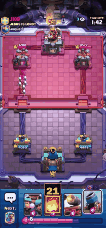
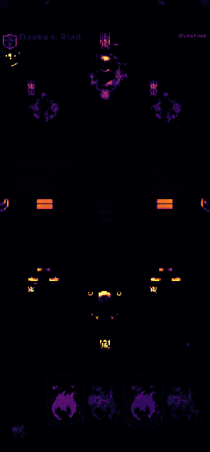
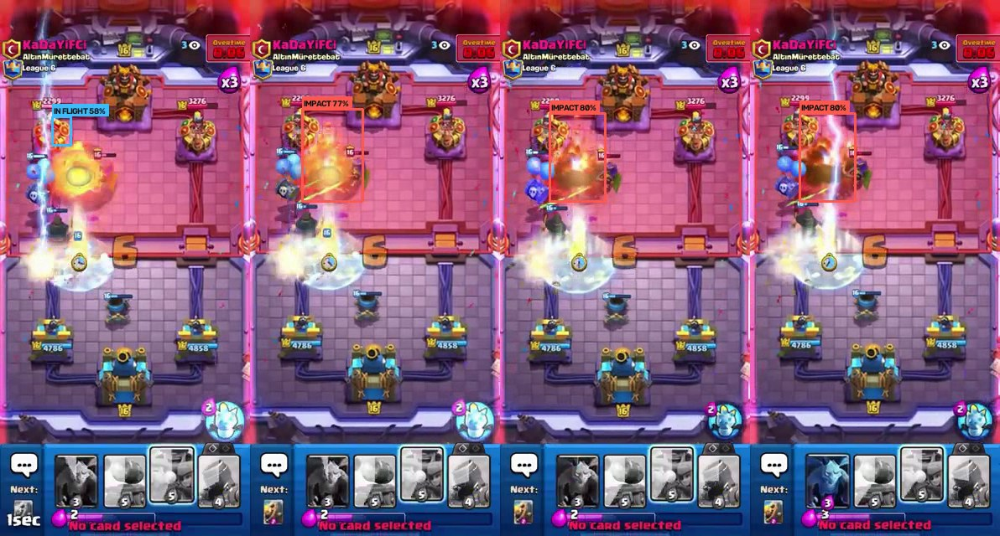

# Spell Cycle Counter

**How many casts does it take to delete that tower?**

Spell cycling is the Clash Royale plan where you ignore the board and chip a
tower down with spells alone. It works because spell damage to a crown tower
is guaranteed: no defence, no blocking, no trading. So the number of casts is
not a guess, it is arithmetic.

This program does that arithmetic for you, live, off a recorded match. It
reads the enemy princess towers' health off their health bars, finds which
spells are sitting in your hand, and prints a number on each one: how many
casts of that spell finish off the weaker tower.



Nine Fireballs would finish that tower, so the card in hand is boxed and
labelled 9. Watch the clip through: the spell gets cast, the detector picks
the projectile up in flight, and then tags the blast where it lands.

Full annotated clip: [`output/videoplayback_spellcycle.mp4`](output/videoplayback_spellcycle.mp4)
(54 seconds, 1619 frames). Single frame: [`output/demo_frame.png`](output/demo_frame.png).

---

## What it detects

Three things:

1. **Spells in the arena** — the projectile in flight and the blast where it
   lands — with a YOLOv8n detector fine-tuned on this game.
2. **The enemy princess towers' health**, from the red fill of their health bars.
3. **Which of your four hand slots hold a damaging spell**, from the card art.

Non-spell cards are deliberately ignored. A Goblin Gang has no guaranteed
tower damage, so no count can be put on it.

## Approach, and why

**The right tool depends on whether the thing moves**, and this project has
both kinds of target, so it uses both kinds of method.

The hand and the health bars never move. They sit at fixed positions in a
rendered interface whose colours and coordinates the game guarantees. A
learned detector would be strictly worse there: more machinery, more failure
modes, and less accuracy than simply reading the pixels. So those use template
matching and a fixed rectangle.

A spell in flight is the opposite. It has no fixed position, no fixed scale,
and it crosses whatever happens to be on the board at the time. No rectangle
and no colour rule can find it, because the arena is full of permanently
orange furniture: bridge gates, king crowns, every gold level badge. That is
what the model is for, and the "The model" section below covers it.

**Hand: template matching against the official card art.** The four slots sit
at fixed screen positions, so each slot is matched against all seven spell
images rather than sliding templates over the whole frame. That is faster and
it structurally cannot put a card in the wrong slot. Card art is downloaded
from RoyaleAPI's asset mirror into `cards/`.

The separation is clean. In the demo frames:

| Case | Match score |
|---|---|
| Fireball really in hand | 0.86 to 0.92 |
| Best false positive (greyed-out post-match card) | 0.72 |
| Everything else | below 0.56 |

Hence the default `--threshold 0.78`.

**Health: measuring the bar, not reading the number.** The game does print the
health as a number, and that was the first thing I tried. It does not survive
this recording. At 298x640 the digits are six pixels tall; I built digit
templates from values I read by eye and tested them on held-out frames, and
`4858` came back as `3038`. That is a resolution limit, not a tuning problem,
so I measured the bar instead. Fitted against four hand-read health values,
the bar lands within 0.3%.

## The model

**YOLOv8n, fine-tuned from COCO weights on frames cut from this video.** Two
classes: `spell_in_flight` and `spell_impact`. Starting from pretrained
weights rather than from scratch matters — a few hundred frames is nowhere
near enough to learn edges and blobs from nothing, but it is plenty to
re-point a backbone that already has them at one new object.

### Getting labels without labelling by hand

Hand-annotating thousands of frames was not realistic, so the labels come
from a two-stage trick that `tools/build_dataset.py` implements:

1. **An impact is easy to find.** A spell blast is far larger than any gold
   badge in the arena, so a strict area threshold catches it. That gives one
   reliable anchor per cast: 28 events across 23 minutes.
2. **A projectile is hard to find, but it has to arrive somewhere.** Searching
   all 42,284 frames for a small orange ball is hopeless. Searching only the
   one second before a known blast, and only near where that blast happened,
   is easy. An impossible global search becomes a trivial local one.

The first version of this labelled bridges as fireballs. The arena is full of
permanently orange furniture, and colour cannot tell a bridge gate from a
projectile. The fix is a **static-orange prior**: sample 798 frames across the
video, measure how often each pixel is orange, and refuse to label anything in
a pixel that is orange most of the time. A spell is by definition transient.
That one filter removed 212 bad labels, and every box in the verification
montage after it was a genuine projectile.



Bright areas are furniture the labeller must ignore: the two bridge gates, the
king crowns, every level badge, the cards in hand.

### Training

| | |
|---|---|
| Base weights | `yolov8n.pt`, COCO-pretrained |
| Classes | `spell_in_flight`, `spell_impact` |
| Source | 28 cast events across 23 minutes of play |
| Train | 915 images: 465 in-flight, 167 impact, 283 negatives |
| Validation | 333 images: 163 in-flight, 53 impact, 117 negatives |
| Epochs | 20, CPU only |
| Image size | 512 long side, rectangular batches |

**Negatives matter as much as positives.** 400 frames with gold badges, king
crowns and fire-effect troops but no spell are included on purpose. Without
them the model learns "orange means spell" and you have trained the colour
rule you were trying to replace.

**The split holds out whole events, never single frames.** Consecutive frames
of one cast are near-duplicates; splitting at random would leak them across
train and validation and make the score meaningless. All 30 frames of a cast
go to the same side of the split.

### Results

On the held-out cast events, which the model never saw in training:

| Class | AP50 | Precision | Recall |
|---|---|---|---|
| `spell_impact` | 0.986 | 0.919 | 0.981 |
| `spell_in_flight` | 0.538 | 0.773 | 0.466 |
| **overall** | **mAP50 0.762** | | **mAP50-95 0.504** |

**The gap between those two rows is the point of the whole exercise.** The
blast is nearly solved at 0.986, and it should be: it is huge, bright and
sits still for a few frames, which is exactly why a colour threshold could
label it in the first place. The projectile scores 0.538 with recall under a
half, because it is a dozen pixels wide, moves the width of itself between
frames, and crosses a background that is already pink and orange.

So the easy class is easy and the hard class is hard, which is the honest
result. The model earns its place on the second row, not the first. Missing
roughly half the in-flight frames still tracks the spell fine in practice,
because a cast lasts 20 to 30 frames and catching a third of them draws a
clean path.



Four frames across one cast: the projectile tagged in flight, then the blast
tagged on impact as it blooms and fades.

## How the code processes the video

`spellcycle.py` runs one loop per frame:

1. **Read each enemy bar.** Convert the bar rectangle to HSV, mask the two red
   hue ranges, and measure how far the filled run reaches from the left edge.
2. **Smooth it.** Covered in detail below, because this is where the real work is.
3. **Pick the target.** The weakest tower still standing. A destroyed tower is
   not a zero-health target, it is removed from the running.
4. **Read the hand** every fifth frame, since a hand only changes when a card
   is played.
5. **Run the detector** on the same fifth frame, giving any spell in flight or
   blast in the arena.
6. **Do the arithmetic.** `ceil(health / crown tower damage)`, which always
   rounds up, because a tower on 1 health still needs a whole cast.
7. **Score the impact.** When a blast appears on the enemy half, note which
   tower it landed on and how much health that tower loses over the next 1.6
   seconds. This is reported as health lost in a window, not as the spell's
   damage, because anything else hitting the tower at the same moment is
   counted too. It is a sanity check on the counter, not a measurement of the
   spell in isolation.
8. **Draw** the spell boxes with their counts, and the detector's boxes on the
   projectile and the blast. The health figures stay off the picture on
   purpose: they are an estimate good to about a bar pixel, accurate enough to
   pick a cast count but not accurate enough to show as if it were the game's
   own number.

### Keeping the health reading honest

A health bar gets walked over by troops, covered by spell animations, and
hidden under the card you are dragging. Three rules handle all of it, and
together they make the estimate monotonic:

- **A hidden bar is unknown, not empty.** If no red is found the frame is
  discarded. Returning zero here was a real bug: the first spell animation
  over the bar latched the tower to dead.
- **The largest recent reading wins.** Anything covering a bar can only make
  the red run look *shorter* than it is, never longer. So across half a second
  the maximum is the honest value. Replacing a median with this one line
  removed every remaining glitch.
- **Towers never heal.** The estimate can only ever fall.

When the bar is unreadable the last good value simply stands. Four seconds of
continuous absence means the tower is gone, since nothing covers a bar that
long but destruction.

### Where the damage numbers come from

This was the fiddliest part to get right, and `tools/build_spell_table.py`
documents it in full. Two traps:

- **Crown tower damage is not area damage.** Spells deal heavily reduced
  damage to towers. A level 11 Fireball does 689 to troops but 159 to a tower.
  Using the wrong one would overstate every count by four times.
- **Every public stat dump is stale.** June 2026 cut the crown tower damage of
  twelve spells at once, and September 2026 cut Fireball again. The game-file
  mirror still carries pre-patch values.

So the table is anchored on the two post-patch values that are published
outright, and every other level is scaled using the game's own per-level
damage ratios. The indexing rule those arrays use is not documented anywhere
I could find, so I derived it and then verified it: array length encodes
rarity, and index equals level minus the rarity's starting level (Common 1,
Rare 3, Epic 6, Legendary 9). Checking it reproduces both published pre-patch
values exactly, 207 for Fireball and 371 for Rocket.

Crown tower damage at level 11, tournament standard:

| Spell | Damage | Casts for a 3052 health tower |
|---|---|---|
| Rocket | 343 | 9 |
| Lightning | 295 | 11 |
| Fireball | 159 | 20 |
| The Log | 49 | 63 |
| Zap | 48 | 64 |
| Giant Snowball | 48 | 64 |
| Arrows | 30 | 102 |

Poison and Earthquake are deliberately excluded. They deal damage over time,
so "how many casts" has no honest answer for them.

## What the custom behaviour does

Detecting things is the easy half. The custom logic is everything that turns
two detections into one actionable number:

- **Picks a target.** The weakest princess tower still standing. A destroyed
  tower is removed from the running rather than treated as a zero-health
  target, which would otherwise make every count read 0.
- **Converts health into casts.** `ceil(health / crown tower damage)`, always
  rounding up, because a tower on 1 health still costs a whole cast.
- **Scales to the spell's level.** `--spell-level` re-reads the whole damage
  table, so a level 14 Rocket correctly needs fewer casts than a level 11 one.
- **Labels the right card.** Each count is drawn on the specific hand slot
  holding that spell, and only on spells, since nothing else does guaranteed
  tower damage.
- **Survives a messy video.** The three rules under "Keeping the health
  reading honest" above are the real work: a bar hidden by a troop or a spell
  animation holds its last value instead of collapsing the count.
- **Watches casts land.** The detector's impact class turns every blast on the
  enemy half into an event: which tower it hit, and how much health that tower
  lost afterwards. That window catches any troop damage landing at the same
  time, so it is a sanity check rather than a clean per-spell measurement, and
  the output says so.
- **Logs every change.** A line is printed whenever the count changes, so the
  run is auditable without scrubbing the video:

```
[ 636.17s] Fireball x9
[ 653.68s] spell impact #1 on the left tower
[ 655.29s]   left tower lost 1080 HP over the next 1.6s
[ 664.03s] Fireball x2
[ 667.70s] spell impact #2 on the left tower
[ 669.30s]   left tower lost 0 HP over the next 1.6s
```

That second impact reporting zero is honest rather than broken: the tower was
already at the floor of what the bar can resolve, so there was nothing left
to measure.

## When nothing is detected

Nothing detected is a normal state here, not an error, and every case is
handled without a traceback:

| Situation | What happens |
|---|---|
| No spell in your hand | nothing is drawn, the video keeps going |
| A bar is covered by a troop or spell | the frame is discarded, last good value holds |
| A tower is destroyed | dropped from targeting after its bar is gone 4 seconds |
| Both towers gone | no target, counts stop being drawn |
| Greyed-out post-match cards | rejected by the match threshold |
| Video file missing or undecodable | one-line error, clean exit |
| `--start` past the end of the video | one-line error, previous output left intact |
| `--spell-level` out of range | one-line error naming the valid range |

## Install

```bash
python -m venv .venv
.venv\Scripts\activate          # Windows
# source .venv/bin/activate     # macOS / Linux

pip install -r requirements.txt
```

Built and tested on Python 3.12.1, Windows 11.

## Run

```bash
# the demo segment. 4858 is the max tower health in this recording, read off
# a full enemy bar; without it the program assumes a level 11 tower and warns.
python spellcycle.py videoplayback.mp4 --start 636 --end 690 --tower-hp 4858

# same thing without the detector, if you would rather not install torch
python spellcycle.py videoplayback.mp4 --start 636 --end 690 --tower-hp 4858 --no-model

# your own spell levels
python spellcycle.py match.mp4 --spell-level 14

# check the maths without touching a video
python tools/test_math.py

# rebuild the damage table after a balance patch
python tools/build_spell_table.py

# retrain the spell detector from scratch (weights are committed, so this
# is only needed for a different game version or a new video)
python tools/build_dataset.py videoplayback.mp4
python tools/train_model.py
```

Output lands in `output/` as an annotated MP4.

| Flag | Meaning |
|---|---|
| `--spell-level` | your spell level, default 11 |
| `--tower-hp` | enemy tower max health, default 3052 (a level 11 tower) |
| `--start` / `--end` | seconds, to cut one match out of a long recording |
| `--threshold` | card match score, default 0.78 |
| `--every` | re-read the hand every N frames, default 5 |

### Using a different recording

The on-screen regions live in `data/layout.json` as fractions of the frame, so
nothing is hard-coded to one resolution. For a new capture:

```bash
python tools/inspect_frame.py yourvideo.mp4 --grid
```

Read the percentages off the grid it draws, then edit the four card slots and
two bar rectangles to match.

## Sample output

Everything in `output/` is committed, produced by the demo command above:

| File | What it is |
|---|---|
| `demo.gif` | the 10 second excerpt shown at the top |
| `videoplayback_spellcycle.mp4` | the full 54 second annotated clip |
| `demo_frame.png` | a single annotated frame |
| `detector_frames.jpg` | four frames across one cast, in flight then impact |
| `orange_prior.png` | the static-orange map the labeller uses |

The trained weights are committed too, at `models/spell_yolov8n.pt` (6.5 MB),
so the repository runs without retraining.

The source recording itself is not committed. It is a 68 MB download and the
repository does not need it to be read, only to be re-run.

## Verification

**The health estimate** drives every count, so it was checked against the
health the game itself prints, on a frame at 776 seconds:

| Tower | Estimated | Game shows | Error |
|---|---|---|---|
| Left | 2969 | 3028 | 59 |
| Right | 4588 | 4572 | 16 |

Both are inside one pixel of bar, which is about 131 health on these towers.
That is why the estimate is used for the arithmetic but never drawn on the
video as a health readout.
`tools/test_math.py` covers the damage table and the cast arithmetic with 19
assertions, including that partial health always rounds up and that dead
towers and unknown spells return nothing instead of crashing.

## Limitations

- **Health is read to about plus or minus 131 points**, one bar pixel on a
  37 pixel bar. That can shift a count by one near a boundary. A higher
  resolution recording would fix this outright by making the printed health
  number readable, and that is the first thing I would add.
- **Maximum tower health is assumed, not detected.** The default is a level 11
  tower at 3052. The demo video has level 16 towers, so it is run with
  `--tower-hp 4858`, a value I read off a full bar in that match.
- **Seven spells are supported.** Adding one is a line in
  `tools/build_spell_table.py` plus its card art.
- **The king tower is not tracked.** It prints no health number and its bar is
  partly behind the king sprite. Spell cycling targets a princess tower anyway.
- **Royal Chef can heal a tower**, which breaks the never-heals assumption. It
  is rare enough that the robustness it buys everywhere else is worth it.
- **One layout per recording.** A different aspect ratio needs the regions
  re-measured.

Model-specific:

- **The labels are weakly supervised, so the in-flight class is noisy.**
  Candidates come from the second before a confirmed blast, which is mostly
  but not only the incoming projectile; a Firecracker's sparks near the same
  spot can be swept in. Every box in the verification montage was a genuine
  fire projectile, but "fire projectile" is a slightly wider class than
  "spell".
- **It does not say which spell it is.** One class covers all of them.
  Identity comes from the hand instead, which is already detected, so the two
  halves could be joined: a Fireball leaving the hand plus a blast arriving is
  a Fireball cast.
- **Trained on 23 minutes of one recording**, so it has seen one arena skin,
  one resolution and one set of card levels. A different arena would need the
  dataset rebuilt, which is one command.
- **CPU-trained and deliberately small.** yolov8n at 512 on rectangular
  batches, chosen so the whole thing retrains in minutes on a laptop rather
  than needing a GPU.
- **The post-impact health drop is not the spell's damage.** It is everything
  the tower lost in that 1.6 second window, troops included. Isolating the
  spell would mean knowing what else was attacking, which this program does
  not track.

## What I would add next

- Read the printed health number on a higher resolution capture and use the
  bar only as a fallback. That removes the `--tower-hp` assumption entirely.
- Detect the tower level badge to set maximum health automatically.
- Count elixir, so the readout could say whether the cycle is actually
  affordable before the match ends.
- Handle Poison and Earthquake as "chip per cast over time" rather than
  excluding them.
